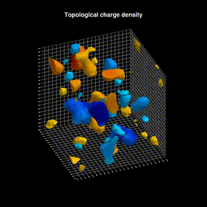

# VisualizingLQCD.jl

Visualization of lattice QCD gauge configurations in Julia.

- A. Tomiya (akio@yukawa.kyoto-u.ac.jp), Y. Nagai



[Another example (YouTube)](http://youtube.com/shorts/nscMhDamzfg)

## Overview

The package reads a gauge configuration (ILDG, JLD2, or Bridge++ format) or
generates one with [Gaugefields.jl](https://github.com/akio-tomiya/Gaugefields.jl),
evaluates a local operator such as the topological charge density or the
action density, and renders the result as still images or movies with
[Makie](https://docs.makie.org).

```
configuration ──> operator ──> LatticeField ──> snapshot / movie
(load_gauge,       (measure)    (4D real field)
 generate_gauge)
```

The fourth lattice direction is Euclidean. Movies step through its slices (or
through gradient-flow time); they never show real-time evolution, and every
movie writes a JSON sidecar recording the frame-to-slice map, the thresholds,
and the operator definition.

## Install

```
pkg> add VisualizingLQCD
```

Julia 1.11 or later is required. Rendering uses GLMakie, so a machine with
OpenGL is needed for movies.

## Quick start

```julia
using VisualizingLQCD

U = load_gauge("Conf24242432beta6.0.ildg"; lattice=(24, 24, 24, 32))

q = measure(TopologicalChargeDensity(), U)   # signed field
s = measure(ActionDensity(), U)              # unsigned field

snapshot("q_slice6.png", q; slice=6, beta=6.0)
movie("action_density.mp4", s; beta=6.0)
```

A sample configuration is available
[here](https://www.dropbox.com/scl/fi/ujkmaeszcm33gku7kl67v/Conf24242432beta6.0.ildg?rlkey=4fyzg3krxsy7azlcjgl68nvsm&dl=0)
(ILDG, 24³×32, β = 6.0, gradient-flowed).

With `beta` the axes are in fm, using the scale of
[hep-lat/9806005](https://arxiv.org/abs/hep-lat/9806005) (valid for
5.7 ≤ β ≤ 6.57); pass `spacing=a_in_fm` instead for other actions, or neither
for lattice units.

## Gauge configurations

```julia
U = load_gauge("conf.ildg"; lattice=(NX, NY, NZ, NT))   # ILDG or Bridge++ need the lattice size
U = load_gauge("conf.jld2")                             # Gaugefields JLD2 checkpoints store it
U = generate_gauge((16, 16, 16, 32); beta=6.0, sweeps=20, flow_steps=200, seed=1)
save_gauge("conf.ildg", U)
```

`generate_gauge` runs the quenched plaquette heatbath and then smooths the
configuration with `flow_steps` steps of the Wilson gradient flow (step size
0.01). Without smoothing the picture is dominated by ultraviolet noise.

## Operators

| Operator | Definition |
| --- | --- |
| `TopologicalChargeDensity(method=:clover)` | q(x) = −1/(32π²) ε_{μνρσ} tr F_{μν} F_{ρσ}; `method` is `:plaquette`, `:clover`, `:alexandrou` (Alexandrou et al. 2015), or `:bilson_thompson` |
| `ActionDensity(method=:plaquette)` | E(x) = 2 Σ_{μ<ν} Re tr(1 − U_{μν}(x)), or its clover version; the volume average is the gradient-flow energy density |
| `PlaquetteDensity(μ, ν)` | 1 − Re tr U_{μν}(x)/N_c for one plane |

The topological charge and action densities come from
[QCDMeasurements.jl](https://github.com/akio-tomiya/QCDMeasurements.jl)
(≥ 1.0.1), so the sum of `TopologicalChargeDensity` over the lattice equals the
charge of `QCDMeasurements.Topological_charge_measurement`. `measure` extends
`QCDMeasurements.measure`, so both packages can be loaded together.

### Your own operators

Three entry points, from the most convenient to the most general. Each
returns a `LatticeField` that renders like the built-in ones. The functions
run on several threads, so they should not modify shared state.

```julia
# a function of the product W(x) of a closed path starting at x
plaquette = LoopDensity([(1, +1), (2, +1), (1, -1), (2, -1)]) do W
    1 - real(tr(W)) / size(W, 1)
end

# a function of the field strengths F[μ, ν] at x (clover, traceless anti-Hermitian)
magnetic = FieldStrengthDensity(signed=false) do F
    -real(tr(F[1, 2]^2) + tr(F[2, 3]^2) + tr(F[3, 1]^2))
end

# anything built from the links around x
plaquette12 = SiteOperator() do ctx, x
    U1 = link(ctx, 1, x); U2 = link(ctx, 2, neighbor(ctx, x, 1))
    U3 = link(ctx, 1, neighbor(ctx, x, 2)); U4 = link(ctx, 2, x)
    1 - real(tr(U1 * U2 * U3' * U4')) / 3
end

field = measure(magnetic, U)
```

A `LatticeField` can also be made directly from any `NX × NY × NZ × NT` array:
`LatticeField(data; name="my_density", signed=true)`.

## Still images and movies

```julia
snapshot(field; slice=6)                     # returns a Makie figure
snapshot("field.png", field; slice=6)        # and saves it
movie("field.mp4", field)                    # fourth-direction slices 1, 2, …, NT
movie("orbit.mp4", field; frames=FixedSlice(6), camera=Orbit(turns=1))
movie("slow.mp4", field; frames=SliceSweep(hold=3, loops=2), framerate=8)
```

| Style | Picture |
| --- | --- |
| `Blob()` | filled, smoothed superlevel solids colored by the local value (default for unsigned fields; VisualQCD-like) |
| `SignedVolume(preset=:balanced)` | separate solids for positive (yellow → red) and negative (cyan → blue) regions (default for signed fields) |
| `SignedContour(preset=:balanced)` | iso-surfaces at symmetric positive and negative levels |
| `LogIsosurface()` | the original renderer: iso-surfaces of −log(p + 10⁻⁷) above mean + 1.2σ |
| `RawIsosurface(thermal=false)` | iso-surfaces of the raw field at high quantiles |

Other keywords: `theme=:light` or `:dark`, `figure_size`, `title`,
`show_axis_labels`, `framerate`.

## Gradient-flow movies

```julia
series = flow_series(U, TopologicalChargeDensity(); steps=0:10:200)   # U is not modified
movie("q_flow.mp4", series; frames=FlowSweep(slice=8))
```

`FlowSweep` keeps one fourth-direction slice and advances the frames in flow
time `t/a²`, with a flow-time label and progress bar. `levels=:per_frame`
(default) picks the thresholds of each flow time from its own field;
`levels=:first` keeps the thresholds of the first one, so the decay stays
visible. Densities saved by another program can be read with
`load_field_series(directory)` (one JLD2 file per flow time) and interpolated
with `resample(series, flow_times)`.

## Reproducing the README sample

```julia
U = load_gauge("Conf24242432beta6.0.ildg"; lattice=(24, 24, 24, 32))
q = measure(TopologicalChargeDensity(), U)
movie("topological_density_noaxis_halfspeed.mp4", q;
    beta=6.0, camera=Orbit(turns=1), frames=SliceSweep(loops=4),
    framerate=8, figure_size=(480, 480), show_axis_labels=false)
```

This gives `128` frames: all `32` slices are shown four times while the camera
completes one turn. The GIF above is downsampled to 300 px.

## Upgrading from 0.0.1

`create_animation(NX, NY, NZ, NT, NC, videoname; beta, filename, level_target, render_style, ...)`
still works and produces the same movies; it is now a thin wrapper around
`load_gauge`, `measure`, and `movie` and will be removed in a later release.
`heatbathtest_4D` is a wrapper around `generate_gauge` and `save_gauge`. See
[NEWS.md](NEWS.md) for the full list of changes.

## Note

- This package is inspired by the [visualization of QCD configurations](http://www.physics.adelaide.edu.au/theory/staff/leinweber/VisualQCD/Nobel/) by Derek B. Leinweber.
- Please mention this package or its movies if you use them in a presentation or paper.
- A similar package is [AnimateLQCD.jl](https://github.com/akio-tomiya/AnimateLQCD.jl).
- Contributions are welcome.
